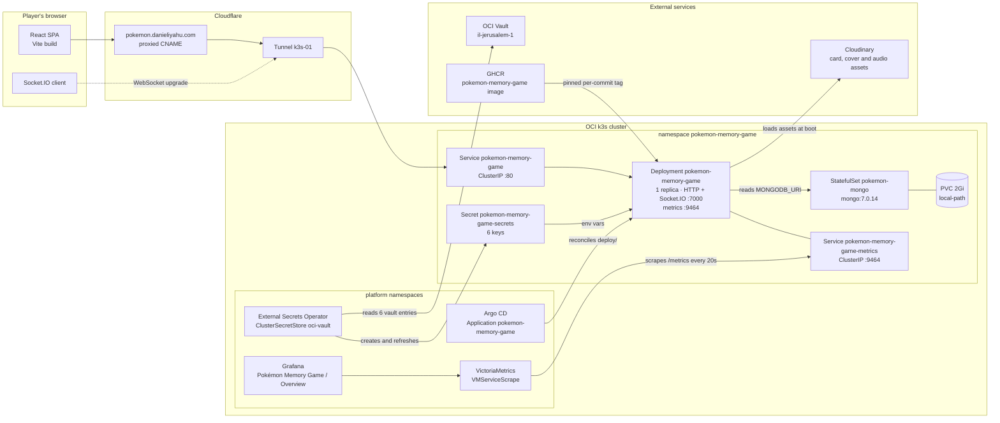
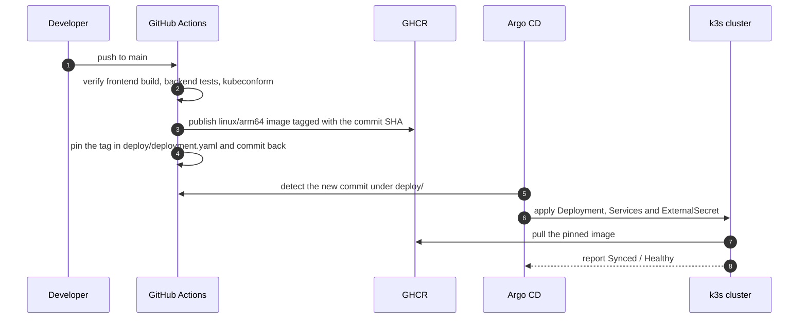

# Pokémon Memory Game

Welcome to the Pokémon Memory Game! This is a fun and interactive memory card game where players match Pokémon cards. The game is designed with a frontend in React and a backend in Node.js using Socket.IO for real-time interactions. Below is a comprehensive guide to setting up and running the project.


## Demo

You can play the game at:
https://pokemon.danieliyahu.com


## Architecture

One Node process serves the built React bundle, the Socket.IO endpoint and the
metrics port; a single-replica Deployment keeps matchmaking and game state in
memory. Only the Cloudflare tunnel can reach the ClusterIP Service, and all
credentials come from OCI Vault at runtime.



### Delivery pipeline

Git is the handoff between CI and the cluster: a push produces an immutable
arm64 image, the workflow pins that tag in `deploy/deployment.yaml`, and Argo CD
rolls the Deployment from the resulting commit.




## Features

- **Real-Time Multiplayer**: Players can join and play games in real-time.
- **Dynamic Card Matching**: Uses Cloudinary for card images and manages game logic.
- **Responsive Design**: Frontend designed for various devices using Tailwind CSS.
- **Game Management**: Handles player connection, game initialization, and game state updates.


## Technology

### Frontend

- **React**: A JavaScript library for building user interfaces. Used for creating the interactive components and managing the state of the game.
- **TypeScript**: A statically typed superset of JavaScript that adds optional types. It ensures better code quality and maintainability.
- **Tailwind CSS**: A utility-first CSS framework for designing the application's responsive and modern UI.
- **Vite**: A build tool that provides a faster development experience. Used for bundling and serving the frontend code.

### Backend

- **Node.js**: A JavaScript runtime built on Chrome's V8 JavaScript engine. Used for building the server-side logic of the application.
- **Express**: A web application framework for Node.js. Handles HTTP requests and serves the frontend assets.
- **Socket.IO**: A library for real-time web applications. Manages real-time bidirectional communication between clients and the server.
- **Cloudinary**: A cloud-based service for managing and delivering images. Used for hosting and fetching Pokémon card images.


## Frontend Overview

The frontend of the Pokémon Memory Game is built with React and uses TypeScript. It consists of the following key components:

- **App**: The main component that sets up routes and integrates the game logic.
- **GameBoard**: Displays the game board with Pokémon cards.
- **Card**: Represents individual cards that users can flip.
- **PlayerStatus**: Shows the current status of players, including their names and scores.
- **GameOver**: A component that displays the game results and allows users to restart the game.

The frontend uses Tailwind CSS for styling and ensures a responsive and interactive user interface.

## Backend Overview

The backend is built with Node.js and Express, with real-time communication handled by Socket.IO. Here’s a brief overview of the backend components:

- **index.ts**: Sets up the Express server, handles CORS, serves static files, and initializes the `GameManager` instance.
- **gameManager.ts**: Manages game state, handles player connections, and interacts with Cloudinary to fetch images. It also handles game logic, such as moves and game initialization.
- **socketHandlers.ts**: Contains event handlers for Socket.IO, managing real-time communication between players and the game server.
- **game.ts**: Defines the game logic, including move validation, card matching, and game-over conditions.
- **player.ts**: Manages player state, including moves and scores.

### Key Features:

- **Real-time Gameplay**: Players can interact in real-time with Socket.IO.
- **Image Storage**: Pokémon card images are stored and fetched from Cloudinary.
- **Game Management**: The `GameManager` class handles game initialization, player management, and game logic.

---

## Running it locally

```bash
npm ci --prefix frontend && npm ci --prefix backend

# Terminal 1 — API, Socket.IO and metrics on ports 7000 / 9464
cd backend && cp .env.example .env   # then fill in the Cloudinary values
npm run dev

# Terminal 2 — Vite on 5173, proxying /api to :7000
npm run dev --prefix frontend
```

`npm test --prefix backend` type-checks and runs the game-logic tests.

## Deployment

The application is delivered to the OCI k3s cluster by Git:

1. A push to `main` runs `.github/workflows/build-and-deliver.yaml`.
2. CI builds and tests the repository, then publishes
   `ghcr.io/danieliyahu1/pokemon-memory-game:<commit-sha>` for `linux/arm64`.
3. CI pins that immutable tag in `deploy/deployment.yaml` and commits the change back.
4. Argo CD reconciles the `pokemon-memory-game` Application from `deploy/`.

Public traffic reaches the ClusterIP Service through the Cloudflare tunnel at
**https://pokemon.danieliyahu.com**. The hostname is declared in the platform
repository (`oci-k3s-starter`, `terraform/locals.tf`, `app_routes`).

### Runtime contract

The Deployment reads one Kubernetes Secret, `pokemon-memory-game-secrets`,
created by the `ExternalSecret` in `deploy/externalsecret.yaml`. It is backed by
OCI Vault through the `oci-vault` ClusterSecretStore. Only the vault entry names
are in Git:

| Vault entry | Used as |
|---|---|
| `pokemon_mongodb_uri` | `MONGODB_URI` — includes the credentials and `authSource=admin` |
| `pokemon_mongodb_password` | `MONGO_ROOT_PASSWORD` for the bundled MongoDB |
| `pokemon_jwt_secret` | `JWT_SECRET` — signs login tokens |
| `pokemon_cloudinary_cloud_name` | `CLOUDINARY_CLOUD_NAME` |
| `pokemon_cloudinary_api_key` | `CLOUDINARY_API_KEY` |
| `pokemon_cloudinary_api_secret` | `CLOUDINARY_API_SECRET` |

`deploy/configmap.yaml` carries the non-secret values, including the pinned
browser origin used by CORS and Socket.IO.

### Components

| Object | Purpose |
|---|---|
| `deploy/deployment.yaml` | one app replica — matchmaking state is in process memory |
| `deploy/service.yaml` | ClusterIP, reached only by the tunnel |
| `deploy/mongodb.yaml` | single-node MongoDB on a 2 Gi `local-path` volume |
| `deploy/metrics-service.yaml` + `vmservicescrape.yaml` | internal `/metrics` scrape |
| `deploy/grafana-dashboard.yaml` | "Pokémon Memory Game / Overview" dashboard |

### Operations

The server exposes Prometheus metrics on port `9464` (never through the public
Service): request rate, error ratio and latency; connected Socket.IO clients;
waiting players and active games; moves, games created and games finished;
Cloudinary asset counts; and MongoDB connection state. The dashboard lives in
the `observability` namespace and is picked up automatically by Grafana.

`GET /healthz` on port `7000` backs the startup, readiness and liveness probes.
